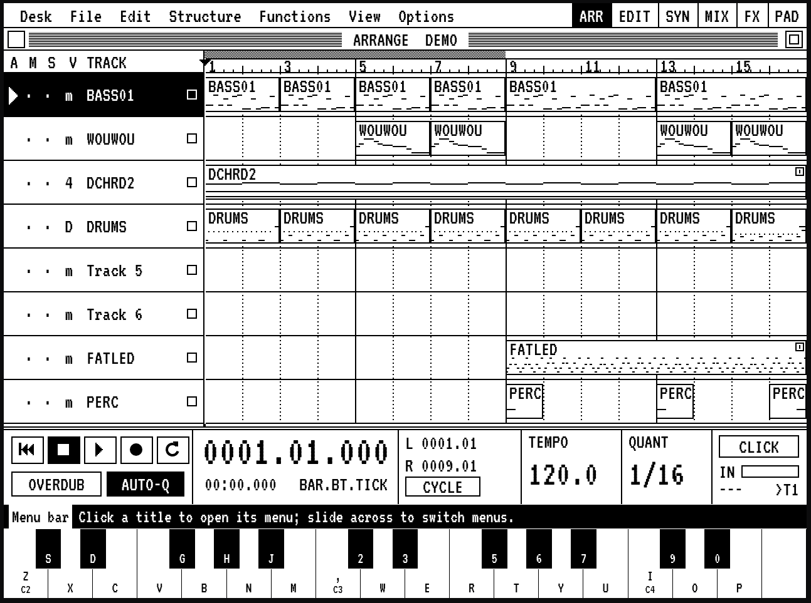

# Arranger ST10

A 1-bit, Atari-ST-style arrange sequencer in the browser. Eight tracks, each a DS-10 style
synth or a DS-10 style drum kit, a mixer (2 inserts per strip, 2 send buses, master),
DS-10 FX / Midiverb / tape delay / distortion / rate crush, and KAOSS-pad automation.

**Run it:** https://ds10fan.github.io/arranger-st10/

The whole app is one self-contained file, `arranger-st10.html`. The manual is built in
(Desk > Manual, F9).

## Building

    python3 build.py            # writes arranger-st10.html from src/
    python3 serve.py [port]     # serves it over HTTPS (default port 9988, self-signed cert)
    tools/publish_pages.sh      # publishes the built file to GitHub Pages
